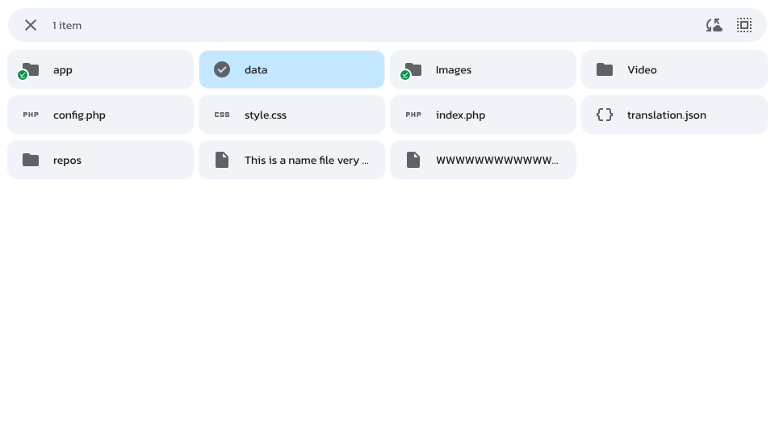
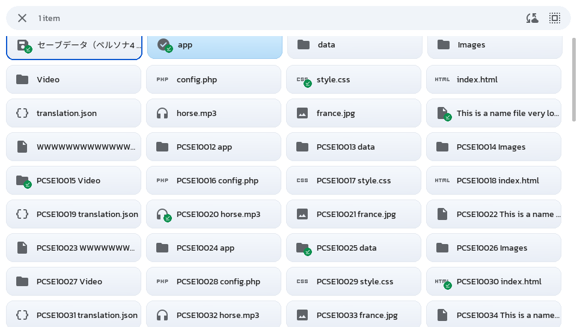
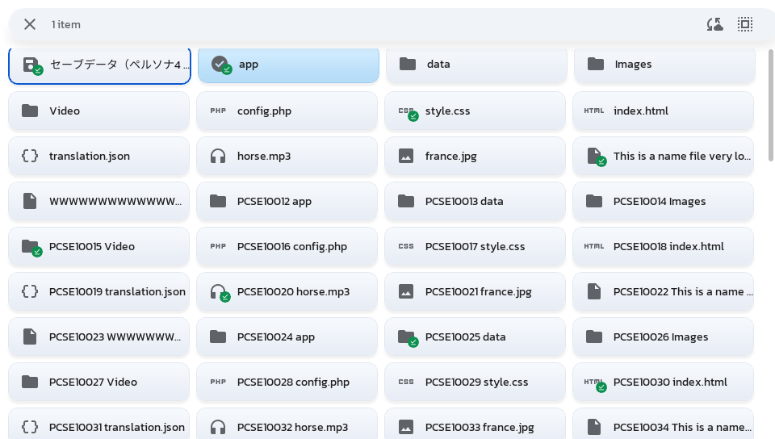
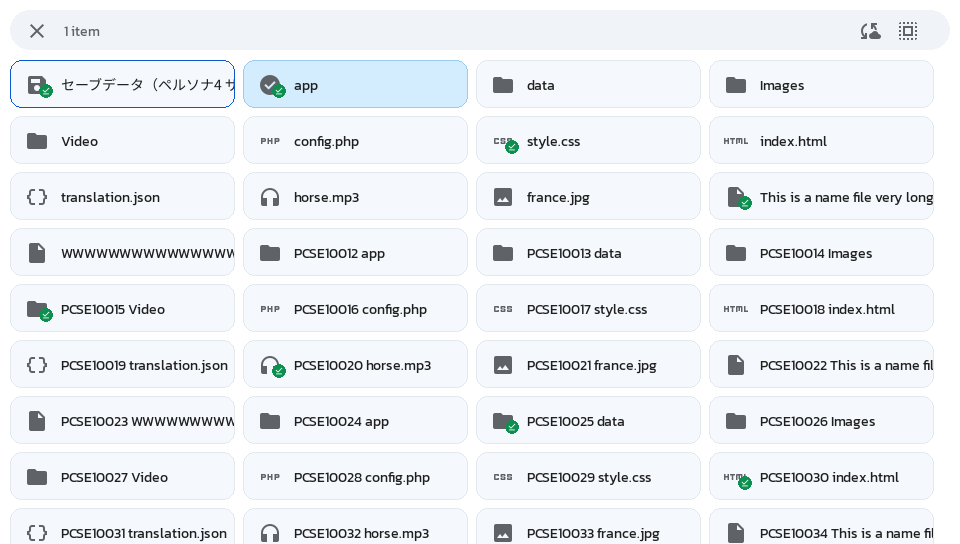

# Spike — UI Stack Benchmark

**Question:** which HTML/CSS-style stack can deliver a UI "never seen on the Vita" within
the console's limits, with buttons, front touch and rear touch?

**Needs:** a real Vita (performance, memory and input cannot be judged in Vita3K).

## Candidates

| # | Stack | Kind | Notes to confirm |
|---|---|---|---|
| A | **RmlUi** | Renderer (RML/RCSS, HTML/CSS-like) | C++; data bindings, animations, transitions, flexbox. Needs a render interface (vita2d or GXM) and a font engine (FreeType). **Verify:** existing Vita ports or backends, license (MIT expected), CSS coverage. |
| B | **litehtml** | Layout engine (real HTML/CSS) | C++; layout only, no scripting, limited interactivity and no animations. Needs a "container" that draws, loads fonts and images. **Verify:** license (BSD expected), how events/focus would be handled. |
| C | **JS engine + React-style library** | Logic layer + renderer | A JS engine (e.g. QuickJS, Duktape) running a React-like reconciler (e.g. Preact) that drives A or B, or a custom renderer. Heavy and experimental. **Verify:** engine footprint on ARMv7, existing reconcilers for RmlUi. |
| D | **Web framework compiled to static files** | Authoring layer | Not a renderer: produces HTML/CSS that A or B renders. Evaluate after A/B, as a developer-workflow question on top of the winner. |

## Reference screen

Build **the same screen in each of A, B and C**: a port of the existing browser prototype
`file_explorer.html/.css/.js` (tile grid, header bar, icons via Material Symbols, selection
state, back navigation). It already exists, so the comparison is fair and the winner's
version is reusable.

Required behaviors in the reference screen:

- 60+ items in a scrollable grid with momentum scrolling
- a transition (e.g. header slide-in when selection starts)
- shadows, rounded corners, gradients
- one string in Japanese (CJK font)
- focus navigation with the D-pad, ✕ to open, ○ to go back
- front touch: tap, long-press to select
- rear touch: scroll the grid

## Criteria

Measured or assessed per stack, recorded in a results table:

| Criterion | How |
|---|---|
| Binary size | VPK / eboot size delta vs. an empty app |
| RAM | Peak heap during the reference screen. **Verify** the memory available to a Vita user app and set the budget from it |
| Frame rate | FPS while scrolling and during the transition; frame-time spikes |
| Startup time | Launch to first frame |
| CSS coverage | Checklist: flexbox, grid, transitions, transforms, shadows, gradients, border-radius, custom fonts |
| CJK text | Correct rendering and line breaking |
| Input | D-pad focus model, front touch gestures, rear touch; effort to build each |
| Backend effort | Work to write or adapt a vita2d/GXM render interface |
| Build integration | Effort to build with VitaSDK CMake; dependencies |
| License | Compatibility with the project license (`copyleft-next-0.3.1`) |
| Upstream health | Release activity, issues, community |
| Authoring experience | How close to real HTML/CSS; hot-reload or fast iteration possible? |

## Decision rule (fixed before results)

1. **Hard gates.** A stack is out if it fails any of:
   - sustains at least 30 FPS while scrolling the reference screen (target 60)
   - peak RAM fits within the budget set from the Vita app limit (with room for sync
     buffers)
   - renders CJK text
   - supports D-pad focus and both touch panels without rewriting the engine
   - license compatible with the project
2. **Then** score the remaining stacks on: visual capability (CSS coverage, animations)
   ×3, performance ×2, authoring experience ×2, backend/build effort ×1, upstream health ×1.
3. If C passes the gates but scores within 10% of A or B, prefer the simpler A or B.
4. Evaluate D on top of the winner: does an existing framework output something the
   winner renders well enough to be worth the extra build step?

## Pros / cons

Filled from the results below. "(hw)" marks a point that still needs the hardware run.

### A — RmlUi
- Pros: RML/RCSS reads like HTML/CSS; data bindings (`data-for`, `{{ }}`, `data-event-click`)
  keep state in C++ without building markup by hand; transitions and animations built in;
  D-pad spatial navigation (`nav-*: auto`) and touch scrolling with inertia work out of the
  box (scripted checks pass); automatic glyph fallback face for CJK; most active upstream.
- Cons: RCSS is not CSS (no grid, `decorator` instead of `background-image`, `dp` units,
  tween names instead of `cubic-bezier`); its best effects (CSS gradients, box-shadow,
  filters, transforms, rounded clipping) need a shader- and layer-capable renderer, which on
  the Vita means vitaGL with the runtime shader compiler or a custom GXM backend; the stock
  SDL backend does not run on the Vita GXM renderer without a patch; largest binary
  (+1.4 MB RmlUi core); keeps font files in heap.

### B — litehtml
- Pros: real HTML and CSS syntax (flexbox, gradients, border-radius); smallest binary of
  the two engines; layout-only design keeps the engine simple to embed.
- Cons: no opacity, transitions, transforms, box-shadow, `gap`, grid or `text-overflow`;
  no events, focus, scrolling or animation: all of it is app code (≈520 lines here for one
  screen); a class change does not restyle, so every state change rebuilds the document
  (cost on the Vita (hw)); element placement API returns empty boxes for flex items at the
  tested commit; slower upstream.

### C — JS + React-style
- Pending: see Results.

### D — compiled framework
- Pros (expected): author with familiar web tooling.
- Cons (expected): output limited by the renderer's CSS support; extra build step.

## Deliverable

This file's **Results** section: the measurements table, filled pros/cons, the decision,
and the reasons. Then update [../vision.md](../vision.md#ui) and
[../ui.md](../ui.md).

## Results

**Status: provisional.** Everything that can be measured without a console is in: builds,
binary sizes, CSS coverage, input checks, licenses, upstream health, and host runs.
Frame rate, RAM and startup on the Vita are **not measured yet**: the VPKs and run
instructions are ready in [benchmarks/ui-stack/](../../benchmarks/ui-stack/README.md).
Stack C is pending. The decision below is provisional until the hardware rows are filled.

### What was built

Each stack renders the reference screen (120 items, 4-column grid, header bar, Material
Symbols icons, sync badges, one Japanese label) inside one shared harness, which runs the
same scripted workload and writes the same results file
([README](../../benchmarks/ui-stack/README.md#the-scripted-run)).

| Variant | Engine | Renderer on the Vita | Notes |
|---|---|---|---|
| `0-empty` | — | SDL2 GXM renderer | Baseline: harness only |
| `A-rmlui` (A-sdl) | RmlUi 6.3 | SDL2 GXM renderer | Stock SDL backend + `rmlui-sdl-straight-alpha.patch`; stylesheet limited to what renders without shaders |
| `A-rmlui-gl3` | RmlUi 6.3 | vitaGL via SDL's GLES2 renderer | Stock GL3 backend + `rmlui-gl3-vitagl.patch`; full stylesheet incl. `explorer-effects.rcss`. Needs `ur0:data/libshacccg.suprx` on the console |
| `B-litehtml` | litehtml (master, after v0.10) | SDL2 GXM renderer | Container (drawing, fonts) and app logic written for this benchmark |
| C | QuickJS + Preact 11 on RmlUi | — | Pending |

Pinned sources (all in `fetch.sh`): RmlUi `ba95ffe` (tag 6.3), litehtml `735a7b3`, QuickJS
`7d1c13c`, Preact 11.0.2, htm 3.1.1, Noto Sans JP from google/fonts `e7db6ca` (static Regular
instance, 5.8 MB). Toolchain: `vitasdk/vitasdk` docker image (GCC 15.2.0, SDL 2.32.8).
Host: Linux, Xeon 2.1 GHz ×4, Mesa llvmpipe through SDL's OpenGL renderer.

### Measurements

| Criterion | A-sdl | A-gl3 | B | Source |
|---|---|---|---|---|
| Builds with VitaSDK | Yes, stock CMake; backend patch (27 lines) | Yes; backend patch (27 lines) | Yes, stock CMake, unpatched | Vita build |
| Eboot (`.self`) size, baseline 1.76 MB | +1.36 MB | +1.12 MB | +0.69 MB | Vita build |
| Code + data, uncompressed, delta | +1.88 MB: RmlUi 1.42, SDL_image + WebP 0.38 (needed by the SDL backend only) | +1.53 MB | +1.33 MB: litehtml 1.02, gumbo 0.24, app 0.03 | Linker maps, `tools/size_by_archive.py` |
| VPK size (incl. 7.1 MB of fonts) | 7.0 MB | 6.8 MB | 6.3 MB | Vita build |
| Peak RAM on the Vita | **needs hardware** | **needs hardware** | **needs hardware** | — |
| RAM budget | newlib heap fixed at 128 MB in every VPK (also the SDK default, `vitasdk/newlib` `sbrk.c`); GPU textures come from separate memory blocks, reported as `free_memory` | | | Source + results file |
| Frame rate, scroll and transition | **needs hardware** | **needs hardware** | **needs hardware** | — |
| Host frame work time p50 / p99 / max, ms (indicative only) | scroll 2.0 / 5.1 / 10.9; transition 2.2 / 8.2 / 16.4 | not meaningful: llvmpipe rasterizes shadows and layers on the CPU | scroll 1.8 / 5.0 / 34.8; transition 1.8 / 5.1 / 25.7 | Host run |
| Startup to first frame | **needs hardware** (host stack init: 15 ms) | **needs hardware** (host: 39 ms) | **needs hardware** (host: 19 ms) | — |
| CJK text | Renders; Noto Sans JP registered as RmlUi's fallback face, no per-string work | Same | Renders; SDL_ttf has no fallback, the container picks a font per word | Screenshots |
| CJK line breaking | Not exercised: every label is `nowrap` | Same | Same | — |
| Input: scripted D-pad, front tap, ○ back | PASS | PASS | PASS | Host run `input_check` lines |
| Input: how it was built | Engine: spatial navigation, touch to click, touch inertia scrolling. App: long-press, rear touch (shared harness code) | Same | App: focus model, hit-testing, drag scrolling and fling, long-press, header buttons, rear touch | Code |
| Backend effort | Small patch to the stock backend | Small patch, plus the shader-compiler dependency (below) | 283-line container + 239-line app layer for one screen | `wc -l` |
| License | MIT | MIT | BSD-3-Clause; bundled gumbo Apache-2.0 | `LICENSE` files |
| Upstream (last 12 months) | 139 commits, 34 authors; releases 6.1 (2025-04), 6.2 (2026-01), 6.3 (2026-08) | Same as A-sdl | 65 commits, 14 authors; releases v0.9 (2024-01), v0.10 (2026-06) | git history (GitHub API not reachable from the benchmark machine; issue counts not collected) |
| Authoring | RML/RCSS + data bindings; close to HTML/CSS, not identical | Same | Real HTML/CSS subset, but no DOM updates: the app regenerates HTML strings | Code |

Startup to first frame is measured from process start (`sceKernelGetProcessTimeWide`) on
the Vita; the host value is not comparable and is left out.

### CSS coverage

As used by the reference screen and checked against each engine's property list.

| Feature | A-sdl (Vita GXM) | A-gl3 | B |
|---|---|---|---|
| Flexbox, wrapping | Yes | Yes | Yes |
| CSS grid | No | No | No |
| `gap` | Yes | Yes | No (margins) |
| `border-radius` | Yes | Yes | Yes (drawn by the container) |
| Rounded clipping (`overflow: hidden` + radius) | No (rectangular scissor) | Yes (clip mask) | No (rectangular) |
| Gradients | Vertex-colour `vertical-gradient` only | `linear-gradient`, radial, conic | `linear-gradient` (container draws it); radial/conic need container work |
| `box-shadow` | No; renders corrupted, so the stylesheet leaves it out | Yes | No |
| `opacity` | Yes | Yes | No (container alpha, set by the app) |
| Transitions / animations | Yes (RmlUi tween functions, no `cubic-bezier`) | Yes | No: app code |
| Transforms | No | Yes | No |
| Filters, `backdrop-filter`, `mask-image` | No | Yes (opacity filter's blend factor ignored on vitaGL) | No |
| `text-overflow: ellipsis` | Yes | Yes | No (clipped) |
| Custom fonts, icon font by code point | Yes | Yes | Yes |

Same moment in each: one item selected, header shown. Host renders (Mesa through SDL's OpenGL
renderer), overlay hidden. The reference is the original `file_explorer.html` in Chromium
(fewer items: it uses the prototype's own sample tree).

| Reference: `file_explorer.html` in Chromium | A-sdl: RmlUi, SDL backend (Vita-equivalent features) |
|---|---|
|  |  |
| **A-gl3: RmlUi, GL3 backend + effects** | **B: litehtml + SDL container** |
|  |  |

A-sdl and B look alike at this size; the differences show in motion (B has no transitions)
and in A-gl3's shadows and gradients.

### Findings

1. **The Vita's SDL2 GXM renderer has no custom blend modes**
   (`VITA_GXM_SupportsBlendMode` returns false), and RmlUi's SDL backend requires them for
   premultiplied alpha (it `#error`s unless SDL's desktop OpenGL renderer is present, which
   the Vita build lacks). The patch switches it to straight alpha: vertex colours and
   generated textures are un-premultiplied before drawing.
2. **Shader effects cost a runtime dependency.** SDL's GXM renderer ships precompiled
   shaders. vitaGL, which RmlUi's GL3 backend needs, compiles GLSL on the console through
   vitashark, which needs `ur0:data/libshacccg.suprx`, a file users have to extract from
   their own firmware. To check on hardware: whether vitaGL's shader cache
   (`HAVE_SHADER_CACHE`, cache path override in `vitaGL.h`) can ship precompiled shaders
   inside the VPK so users never need it; and whether RmlUi's `#version 330` shaders get
   through vitaGL's translator at all. A custom GXM render interface with offline-compiled
   shaders is the other route.
3. **RmlUi's box-shadow on a renderer without layers draws garbage** (grey bars, black
   corners), not nothing: the effects stylesheet must be chosen per renderer.
4. **litehtml cannot restyle in place.** `html_tag::refresh_styles` only re-evaluates the
   selectors that matched when the document was parsed, so adding `selected` to a tile
   changes nothing. `apply_stylesheet` would add the new rules, but it appends to the
   element's matched-selector list on every call, so the list grows with each toggle.
   The benchmark therefore rebuilds the 120-tile document on every selection or focus
   change: up to 25–48 ms on the host per rebuild. On a 333 MHz Cortex-A9 this is the
   number most likely to break the 30 FPS gate (hw).
5. **litehtml `element::get_placement()` returns empty boxes** for the flex items at the
   tested commit; hit-testing goes through `get_element_by_point`, and scroll-into-view
   uses the known row height.
6. **RmlUi logs "Data array index out of bounds"** once per removed row when a bound array
   shrinks (leaving a folder). Harmless, but it floods the log.
7. Host-only: SDL's software renderer drops glyphs smaller than about 2 px (the `.` in
   file names), and mixing SDL's GL renderer with raw GL needs `GL_UNPACK_ROW_LENGTH`
   reset. Neither affects the Vita builds.

### Decision (provisional)

Hard gates:

| Gate | A-sdl | A-gl3 | B |
|---|---|---|---|
| ≥ 30 FPS while scrolling | hw | hw | hw |
| Peak RAM within budget | hw | hw | hw |
| Renders CJK | Pass | Pass | Pass |
| D-pad focus and both touch panels without rewriting the engine | Pass | Pass | Pass (all in app code, the engine untouched) |
| License compatible with copyleft-next 0.3.1 | Pass | Pass | Pass |

License: copyleft-next 0.3.1 §4 allows incorporating material under licenses that are both
OSI-approved and FSF-free (MIT, BSD-3-Clause, Apache-2.0 and the SIL OFL 1.1 for fonts all
are), and §5 requires a source URL with any object-code release.

Scores on the criteria that do not need hardware (1–5; performance ×2 is left out until
the hardware run):

| Criterion (weight) | A-sdl | A-gl3 | B |
|---|---|---|---|
| Visual capability (×3) | 3 | 5 | 2 |
| Authoring experience (×2) | 4 | 4 | 3 |
| Backend / build effort (×1) | 4 | 3 | 2 |
| Upstream health (×1) | 5 | 5 | 3 |
| **Total without performance** | **26** | **31** | **17** |

**Leading candidate: A, RmlUi.** B delivers real HTML/CSS syntax, but everything that makes a
UI feel alive (state changes, focus, scrolling, animation, opacity) has to be written around
it, and its restyle-by-rebuild model is a performance risk. Inside A, the renderer is the
open question for the hardware run:

1. Run all four VPKs and fill the hardware rows.
2. If A-gl3 holds 30 FPS and vitaGL's shader cache can ship in the VPK → A-gl3.
3. Otherwise → A-sdl for v1, and a custom GXM render interface (precompiled shaders) as the
   path to shadows and CSS gradients.
4. Evaluate C on top of A (pending), then D on top of the winner.

[../vision.md](../vision.md#ui) and [../ui.md](../ui.md) stay unchanged until the decision
is final.